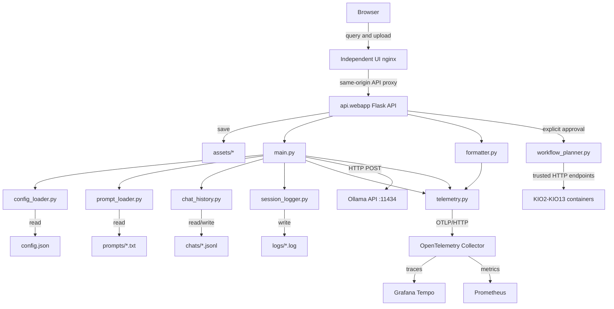

# Architecture

## Overview

KIO1 Orchestrator is an API that sends natural-language user requests to external Ollama and returns structured JSON. An independent UI project serves the existing browser interface and proxies same-origin API requests. An independent dummy-kios project provides test receivers. KIO1 stores uploads under `assets/<category>/` and exports optional privacy-safe OpenTelemetry traces and metrics. Every project builds from its own checkout without sibling imports.

## System Diagram

## Components

| Module | Responsibility |
|--------|---------------|
| `main.py` | Entry point; startup (config, preload, chat file), `run_turn()` turn logic, Ollama request/response handling |
| `api/webapp.py`, `webapp.py` | Flask API and compatibility import: settings, health, history, chat, uploads, and workflow dispatch |
| `config_loader.py` | Loads and validates `config.json` into a typed `Config` dataclass |
| `session_logger.py` | Per-session log file setup and duration measurement |
| `prompt_loader.py` | Loads and validates the shared capability catalog and expands it into system prompt templates |
| `capabilities.json` | Replaceable agent descriptions and capability names shared by prompting and workflow validation |
| `chat_history.py` | Manages JSONL-based conversation persistence |
| `formatter.py` | Pretty-prints JSON responses for structured rendering in the UI |
| `workflow_planner.py` | Validates plans and dependencies; sends versioned tasks to trusted agent endpoints in bounded batches |
| `telemetry.py` | Initializes OpenTelemetry, creates spans and metrics, records metadata, and flushes exporters |
| `assets/` | Uploaded models/datasets/files, split into `models/`, `datasets/`, `files/` subfolders (git-ignored, not committed) |
| `observability/` | Defines the persistent Collector, Tempo, and Prometheus services |

## Data Flow

1. A session ID is generated, logging is initialized, and configuration is loaded.
2. OpenTelemetry is initialized when `telemetry.enabled` is `true`.
3. Inside the startup trace, the system prompt is loaded and Ollama preloads the model using the configured `keep_alive`.
4. A new JSONL chat file is created and the session-started metric is recorded.
5. Flask starts the API at `http://<KIO1_WEB_HOST>:<KIO1_WEB_PORT>` (local defaults `127.0.0.1:5000`). Docker binds all interfaces and keeps the API private. UI publishes host loopback port 5000, loads `/api/settings`, and initializes history. UI serves browser assets, not Flask.
6. The conversation selector lists existing JSONL chats by their first user query. Creating or activating a chat changes the app's active chat file under the session lock; the browser loads only user and assistant messages, never the system prompt.
7. For each user request, `POST /api/chat` loads the active chat's prior messages, adds the new query, and sends the full conversation to Ollama inside a turn trace (`main.run_turn`).
8. The raw model response is printed to server stdout. The formatted response is returned to the browser, which renders workflow plans as readable step cards and other JSON as labeled fields; the user and assistant messages are appended to the active chat file.
9. Uploaded files sent to `POST /api/upload` are saved under `assets/<category>/` (`models/`, `datasets/`, or `files/`, chosen from a fixed mapping of the request's `category` field) with a sanitized, collision-resistant filename.
10. Throughout startup and each turn, telemetry records privacy-safe request metadata, token usage, durations, traces, and metrics without prompt or response content.
11. On shutdown, the session-completed metric is recorded and pending telemetry is flushed.

## Optional Workflow Execution

Generating a plan remains side-effect free. Container Make targets mount the dummy registry by default; local runs need `KIO1_AGENT_CONFIG` configured. An operator must still approve dispatch through `POST /api/workflows`. The planner validates every step, resolves endpoints from a trusted JSON registry, and sends only ready tasks. Sequential plans inherit the prior step as a dependency; mixed plans must state dependencies explicitly. Up to four independent tasks run at once. Successful results flow to dependents; failed/unknown outcomes stop further scheduling without cancelling already-running tasks.

Workflow execution has a separate process-local lock, so the app rejects a second execution with 409. It has no durable queue or restart recovery. Task results are returned to the browser but are not appended to conversation history. Workflow and HTTP task spans plus ID/status/duration logs omit payloads and credentials. See the [container contract](workflow-contract.md) for receiver requirements.

## Design Decisions

- **Standard-library Ollama client**: Ollama requests use `urllib.request`, avoiding an additional HTTP dependency.
- **Flask API and nginx UI**: Flask retains routing, multipart parsing, state, and locks. Nginx serves independently built static assets and proxies without buffering or retrying workflows. A settings request replaces Jinja page interpolation.
- **Single shared chat session**: the web UI serves one operator at a time, mirroring the REPL it replaces — a single lock-guarded session keeps turn numbering and chat-file writes consistent.
- **JSONL chat storage**: Each message is a single JSON line, enabling append-only writes and simple streaming reads.
- **Model preloading**: The model is loaded into Ollama memory at startup using configured `keep_alive` to reduce cold-start latency.
- **JSON-forced output**: The Ollama request includes `"format": "json"` to guarantee structured responses from the model.
- **Per-session logging**: Each run writes `logs/log_<session_id>.log` at `DEBUG`, paired with its `chats/chat_<session_id>.jsonl` by a shared id. Only `ERROR` reaches the console, keeping interactive output clean.
- **Response output**: raw model responses are printed to server stdout for operator inspection; telemetry excludes prompts and responses.
- **Sanitized, non-overwriting uploads**: upload filenames are passed through `secure_filename()` and prefixed with a short id, preventing path traversal and silent overwrites.
- **Optional telemetry**: OpenTelemetry is disabled by default, allowing KIO1 to run without Docker or a Collector.
- **Privacy-aware instrumentation**: Telemetry contains operational metadata but excludes prompts, responses, exception messages, and stack traces.
- **Persistent observability storage**: Collector queues, Tempo traces, and Prometheus metrics use named Docker volumes that survive container recreation.

