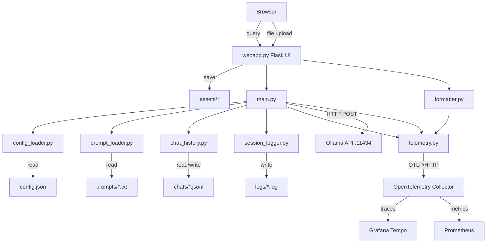

# Architecture

## Overview

KIO1 Orchestrator is a browser-based chat UI that sends natural-language user requests to a local Ollama model and renders the model's structured JSON reply, messenger-style. Models, datasets, or other files can be uploaded from the UI via dedicated buttons and are stored under `assets/<category>/`. Optional OpenTelemetry instrumentation exports privacy-safe traces and metrics.

## System Diagram

## Components

| Module | Responsibility |
|--------|---------------|
| `main.py` | Entry point; startup (config, preload, chat file), `run_turn()` turn logic, Ollama request/response handling |
| `webapp.py` | Flask app: serves the chat UI, conversation history, `/api/chat`, and `/api/upload` routes |
| `config_loader.py` | Loads and validates `config.json` into a typed `Config` dataclass |
| `session_logger.py` | Per-session log file setup and duration measurement |
| `prompt_loader.py` | Reads system prompt text from disk |
| `chat_history.py` | Manages JSONL-based conversation persistence |
| `formatter.py` | Pretty-prints JSON responses for structured rendering in the UI |
| `telemetry.py` | Initializes OpenTelemetry, creates spans and metrics, records metadata, and flushes exporters |
| `templates/`, `static/` | Chat UI markup, styling, and client-side JSON rendering |
| `assets/` | Uploaded models/datasets/files, split into `models/`, `datasets/`, `files/` subfolders (git-ignored, not committed) |
| `observability/` | Defines the persistent Collector, Tempo, and Prometheus services |

## Data Flow

1. A session ID is generated, logging is initialized, and configuration is loaded.
2. OpenTelemetry is initialized when `telemetry.enabled` is `true`.
3. Inside the startup trace, the system prompt is loaded and Ollama preloads the model using the configured `keep_alive`.
4. A new JSONL chat file is created and the session-started metric is recorded.
5. The Flask app is started and serves the chat UI at `http://<KIO1_WEB_HOST>:<KIO1_WEB_PORT>` (defaults `127.0.0.1:5000`).
6. The conversation selector lists existing JSONL chats by their first user query. Creating or activating a chat changes the app's active chat file under the session lock; the browser loads only user and assistant messages, never the system prompt.
7. For each user request, `POST /api/chat` loads the active chat's prior messages, adds the new query, and sends the full conversation to Ollama inside a turn trace (`main.run_turn`).
8. The raw model response is printed to server stdout. The formatted response is returned to the browser, which renders workflow plans as readable step cards and other JSON as labeled fields; the user and assistant messages are appended to the active chat file.
9. Uploaded files sent to `POST /api/upload` are saved under `assets/<category>/` (`models/`, `datasets/`, or `files/`, chosen from a fixed mapping of the request's `category` field) with a sanitized, collision-resistant filename.
10. Throughout startup and each turn, telemetry records privacy-safe request metadata, token usage, durations, traces, and metrics without prompt or response content.
11. On shutdown, the session-completed metric is recorded and pending telemetry is flushed.

## Design Decisions

- **Standard-library Ollama client**: Ollama requests use `urllib.request`, avoiding an additional HTTP dependency.
- **Flask for the web UI**: the browser UI and file uploads need routing and multipart form parsing; Flask is a small, widely used dependency that covers both without hand-rolling an HTTP server.
- **Single shared chat session**: the web UI serves one operator at a time, mirroring the REPL it replaces — a single lock-guarded session keeps turn numbering and chat-file writes consistent.
- **JSONL chat storage**: Each message is a single JSON line, enabling append-only writes and simple streaming reads.
- **Model preloading**: The model is loaded into Ollama memory at startup using configured `keep_alive` to reduce cold-start latency.
- **JSON-forced output**: The Ollama request includes `"format": "json"` to guarantee structured responses from the model.
- **Per-session logging**: Each run writes `logs/log_<session_id>.log` at `DEBUG`, paired with its `chats/chat_<session_id>.jsonl` by a shared id. Only `ERROR` reaches the console, keeping interactive output clean.
- **Response output**: raw model responses are printed to server stdout for operator inspection; telemetry excludes prompts and responses.
- **Sanitized, non-overwriting uploads**: upload filenames are passed through `secure_filename()` and prefixed with a short id, preventing path traversal and silent overwrites.
- **Optional telemetry**: OpenTelemetry is disabled by default, allowing KIO1 to run without Docker or a Collector.
- **Privacy-aware instrumentation**: Telemetry contains operational metadata but excludes prompts, responses, exception messages, and stack traces.
- **Persistent observability storage**: Collector queues, Tempo traces, and Prometheus metrics use named Docker volumes that survive container recreation.

